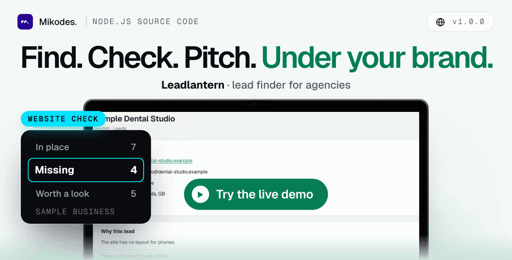
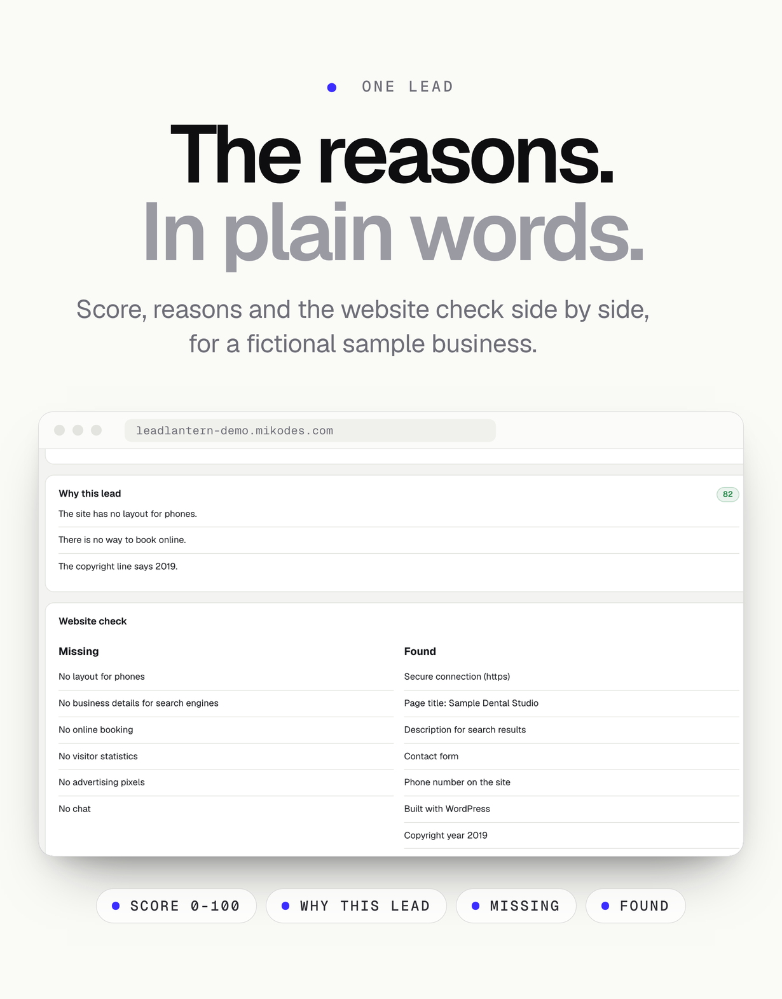
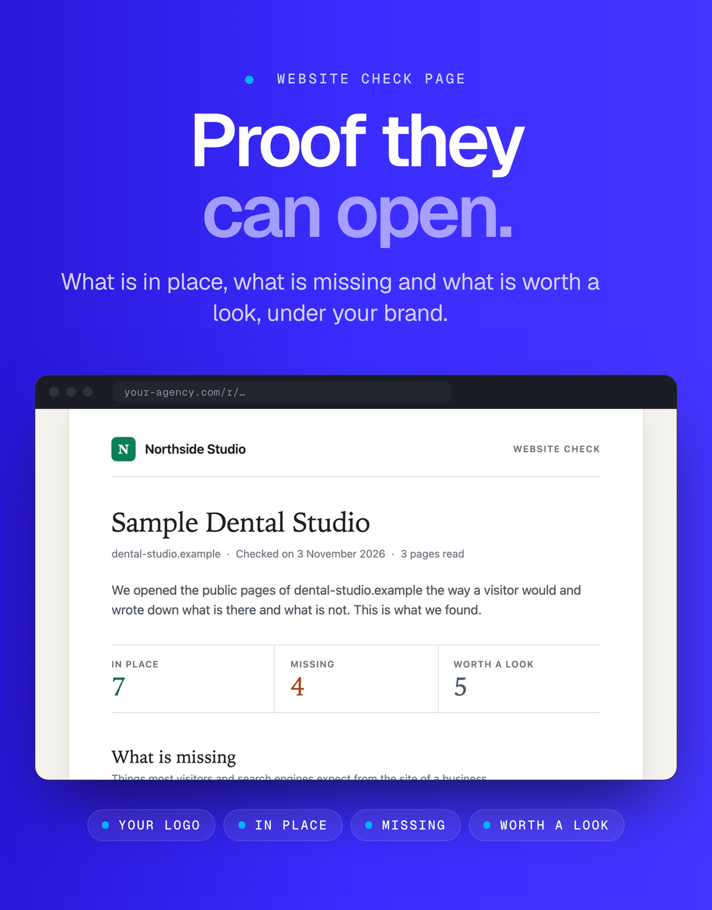
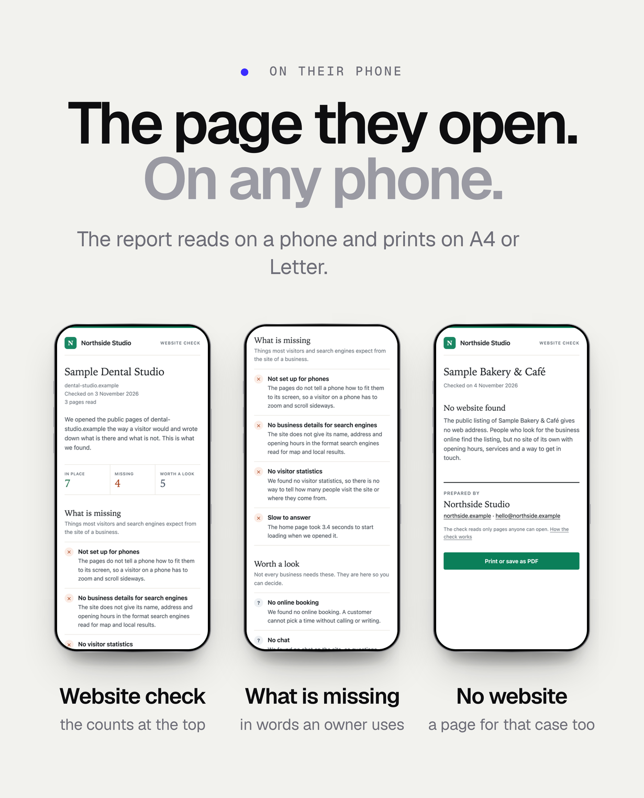

  

<h1 align="center">Leadlantern</h1>

  <b>Local lead finder for agencies (Node.js).</b>

  <a href="https://leadlantern-demo.mikodes.com/"><b>▶ Live demo</b></a> ·
  <a href="https://store.mikodes.com/p/leadlantern/"><b>Get the full source code</b></a>

  
  

  

> **This repository is a showcase.** It holds screenshots, documentation pointers and a real excerpt
> from the code. The full application is sold as source code at
> **[store.mikodes.com/p/leadlantern](https://store.mikodes.com/p/leadlantern/)**: one payment, instant ZIP download, free setup help.

---

## What it is

Find local businesses by type and area from OpenStreetMap (no key needed) or the Google Places API, score them, check their websites and keep the leads in a pipeline your agency can work from.

## Screens

 

## Features

- **Find local businesses from OpenStreetMap**: Search one business type in one area without any account.
- **Lead store with de-duplication, role e-mails only**: Running the same search twice adds nothing new.
- **Website check**: Home page plus up to four contact/about/booking pages: https, phone layout, title/description/H1, structured data, analytics and pixels, booking and chat….
- **Opportunity score for the service the agency sells**: 0-100 score with up to six plain-sentence reasons the agency can say to the business.
- **White-label 'Website check' report page**: Unguessable link with the agency's brand, logo and accent, what was found and what is missing, view counter, noindex.
- **First e-mail or call script: template or AI with the buyer's key**: Draft from the audit facts only.
- **One-click sending through Resend under a server-side guard**: Each send is one person's click.
- **Unsubscribe link and do-not-contact list**: Works without a session, any number of times, for addresses without a lead.
- **Pipeline with stages, notes, tasks, deal values and CSV export**: Follow each business to a signed client. Replies are not read from a mailbox: a person moves the lead to 'Replied'.
- **Links to your website builder and phone receptionist on won leads**: When the agency runs a website builder or a phone answering service for clients, a won lead shows a button that opens it. Only links.
- **Operator console**: Setup with a one-time code, owner/manager/viewer roles, keys stored encrypted, audit log of every write, status checks.
- **Read-only demo mode with labelled sample data**: For a public demo host only.

## How it works

A technical case study of the architecture, one end-to-end flow, the key engineering decisions and how you would build something like this: **[docs/HOW-IT-WORKS.md](docs/HOW-IT-WORKS.md)**.

## A look at the code

Real excerpts from the source, shown for illustration:

- **Explainable opportunity score** ([`snippets/score-lead.ts`](snippets/score-lead.ts)): An explainable opportunity score for a local business. Every rule is a point value plus one plain sentence and fires only on a fact that was really checked, so the result is a 0-100 score with reasons you can quote in a first message.
- **Guard rules before a cold e-mail goes out** ([`snippets/outreach-guard.ts`](snippets/outreach-guard.ts)): A first message is checked against wording rules (no fake "Re:" subject, no promised results) and a daily limit, and sends run one at a time. Every rule returns a plain-English reason, so a blocked message tells the person exactly what to change.
- **robots.txt the way RFC 9309 describes it** ([`snippets/robots-txt.ts`](snippets/robots-txt.ts)): The website check reads robots.txt first: the group that names the tool wins over the wildcard group, the longest matching rule decides, a tie goes to Allow, and wildcards in paths are matched without building a regular expression from untrusted text.

## Requirements (full version)

- Node.js 26 LTS
- Build tools for better-sqlite3 when no prebuilt binary exists
- Linux server or VPS
- ADMIN_SECRET_KEY
- Optional, billed to the buyer: Google Places API
- Optional, billed to the buyer: Resend account with a verified sending domain

Not included: Hosting, server, domain and TLS certificate; Google Places API usage; Resend plan and sending domain; AI provider usage; Own Overpass/Nominatim server if the shared public OpenStreetMap servers are too slow or busy.

## Get the full source code

  

One payment, full licence, instant ZIP download and free setup help.
Questions: [mikodes.com/support](https://mikodes.com/support).

---

  Made by <a href="https://mikodes.com"><b>MIKODES</b></a> · <a href="https://github.com/Mikodesteam">more projects</a>

