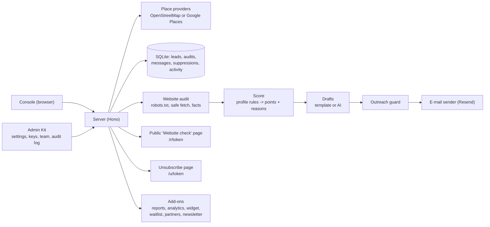

# How Leadlantern works

A case study of a self-hosted lead-finding and outreach tool for small agencies that sell services (websites, SEO,
online booking, ads, phone reception) to local businesses. It is written from the real code; the excerpts linked
below are verbatim pieces of it. The complete application is not in this repository.

## The problem

An agency that sells to dentists, restaurants or plumbers needs three things in a row: a list of businesses in an
area, a reason to talk to each one that is true and specific, and a way to write to them that does not get the
sender in trouble. Scraping tools give the list but not the reason; mass-mailers give the sending but not the
restraint. Leadlantern ties the three together: **find, check the website, score, draft, send under a guard,
track**, in a small server the agency runs itself, with its own keys for place data, e-mail and AI.

## Architecture

One Node.js server (Hono, SQLite) serves a console UI, public pages (report page, unsubscribe page) and a REST-like
API. Optional add-ons plug in through a small interface.

- `src/places` has two interchangeable providers: OpenStreetMap (no key) and Google Places (the buyer's key).
- `src/audit.ts` reads a business's public website and writes down facts; `src/score.ts` and `src/profiles.ts`
  decide what the facts are worth for the service the agency sells.
- `src/leads.ts` is the store: leads, stages, notes, tasks, de-duplication.
- `src/outreach.ts` is the guard and the sender; `src/drafts.ts` writes the first message.
- `src/addons.ts` defines the add-on interface (settings sections, console pages, routes, a lead panel, hooks for
  new leads and stage changes, a per-minute tick).

## One flow end to end: from "dentists in Bratislava" to a sent first e-mail

1. **Search.** The person picks an area and a business type (40 types, each mapped to OpenStreetMap tags and to a
   Google text-search phrase). With OpenStreetMap, one request resolves the area name to an object and a second
   asks for named businesses inside it. The text typed by the person travels as a query parameter and **never
   becomes part of the query language**: the Overpass query is built only from tag filters in the code and numbers
   returned by the geocoder.
2. **Save.** `upsertLead` inserts a lead or refreshes the one already saved for the same provider and provider id.
   Fields a person may have changed (stage, owner, score, a hand-typed e-mail) are left alone on a refresh, and an
   empty provider value never overwrites a saved one. Only role addresses a business publishes (info@, hello@)
   are kept; personal addresses are dropped.
3. **Check the website.** The audit reads robots.txt first ([excerpt](../snippets/robots-txt.ts)), then the home page
   and at most four contact/about/imprint/booking pages, one at a time, through a fetcher that refuses private
   addresses. It writes down facts only: mobile layout, title, contact form, booking tool, HTTPS and so on.
4. **Score.** Facts are turned into a 0-100 opportunity score for the service the agency sells
   ([excerpt](../snippets/score-lead.ts)). Each rule is a point value with a plain sentence, and a rule fires only on
   a fact that was really checked.
5. **Draft.** A first e-mail (or a call script) is produced from a template or, if the agency set an AI key, by a
   model, with the template as the fallback. The strongest reasons from the score are available to quote.
6. **Share the evidence.** An unguessable link opens a white-label "Website check" page for the business owner:
   what was found, in plain words, with no score and no sales reasoning, printable to PDF.
7. **Send under the guard.** On "Send", every guard rule is evaluated against the database
   ([excerpt](../snippets/outreach-guard.ts)). If any rule fails, the message is marked *blocked* with the first
   failing code, every rule's result is stored with the message, an activity entry and an audit log entry are
   written, and nothing leaves the server. Otherwise the message is sent with a footer (who sends it, postal
   address, unsubscribe link) and `List-Unsubscribe` plus one-click headers.
8. **Track.** The lead moves through stages (new, qualified, contacted, replied, meeting, won, lost) with notes,
   tasks and a deal value. An unsubscribe puts the address (or domain) on a suppression list that the guard reads.

## Key engineering decisions

### 1. A guard that blocks with reasons, instead of a "be careful" warning

*Chosen:* a pure list of rules, each returning a code, a pass flag and a sentence in plain English. The UI can show
all rules before sending (nothing is changed by reading them) and the send path runs the same function.
*Alternative:* validate in the UI only, or warn. *Why:* the dangerous action is the send. Keeping one source of truth
means the button, the API and the add-ons cannot disagree, and the sentence tells a non-technical person what to
change. Limits come from console settings but are clamped to a range, so "0" or a typo can never switch a rule off.

### 2. Sends are serialized

*Chosen:* sends on one database run one after another, each seeing what the previous one recorded.
*Alternative:* check then send concurrently. *Why:* with concurrent checks two clicks could both pass the daily
limit or the gap between sends. A tiny promise chain is simpler than locks and fits a single-process server.

### 3. Explainable scoring instead of a model

*Chosen:* a table of rules per sales profile (website, SEO, booking, ads, reception); each has points, a sentence
and a condition on audited facts. *Alternative:* an AI "lead quality" number. *Why:* the agency must be able to say
*why* it is writing to this business, and the reasons double as the first sentence of the e-mail. Rules that depend on
a fact the audit could not verify simply do not fire.

### 4. The report page shows facts, not the sale

*Chosen:* the public page shows what the audit found and what is missing, with no score, no reasons list and no
e-mail read from the site. The link is a random token, one per lead and audit; an unknown token answers like any
missing page. *Alternative:* send the internal analysis. *Why:* the reader is the business owner. A page that reads
like a sales sheet is not credible; one that reads like a visitor's notes is.

### 5. Add-ons through a narrow interface

*Chosen:* a typed `Addon` interface (settings, pages, routes, hooks, a tick) and a fixed list of known add-on
folders. Each add-on's tables are prefixed with its id, and public routes validate their own input and limit their
own rate. *Alternative:* a plugin system with arbitrary loading. *Why:* the core stays small and testable, and a buyer
can add a seventh add-on by copying one folder.

## Security and safety measures that exist in the code

- **Outbound requests to addresses typed by a person** (webhook endpoints, calendar feeds, websites to audit) go
  through one module: https only, no credentials in the URL, standard port, no local names, and the host name is
  resolved and **every** returned address must be public. Numeric block lists cover private, loopback, link-local,
  carrier-grade NAT, documentation and multicast ranges for IPv4 and IPv6, including IPv4-mapped forms. In production
  the check happens inside the connection's own DNS lookup, so the address checked is the address used and DNS
  rebinding has no gap. Redirects are followed at most three hops, each validated, and the body is read as a stream
  and abandoned past a byte limit.
- **Console sessions and CSRF.** Every console page and API route needs a session with a role (viewers read,
  managers change data, owners delete). Every write needs a custom header that a cross-site form cannot send and a
  same-origin `Origin`; the read-only demo refuses writes altogether.
- **Secrets.** Keys the add-ons keep are sealed with AES-256-GCM using keys derived with HKDF from the server
  secret; signed values (report, unsubscribe and portal links) use HMAC-SHA-256 compared in constant time.
- **Unsubscribe.** The link is signed, needs no session and names no lead; the page answers the same whether or not
  the address is known; a GET changes nothing (mail scanners open links) and a POST unsubscribes; masked address
  shown on the confirmation; the endpoint is rate limited.
- **Politeness.** robots.txt is obeyed (RFC 9309), at most five pages are read per site, one at a time, with an
  identifying agent name.
- **Read-only demo mode.** Sample businesses are fictional (`.example` addresses) and every write is refused.

## How you would build something like this

1. **Start with the lead store and its de-duplication rule.** Decide the identity of a lead (provider plus provider id)
   and which fields a person may overwrite, before any scraping. Everything later depends on it.
2. **Put a provider interface in front of place data** so OpenStreetMap, Google and anything else are
   interchangeable, and make every provider return the same small shape. Treat provider terms as part of the design
   (some fields may only be cached for a limited time).
3. **Write the fetcher before the audit.** A safe, capped, redirect-aware fetch with its own tests; the audit then
   cannot accidentally be unsafe.
4. **Make the audit produce facts, not opinions.** Booleans and counts with a status. Judgement lives in the score.
5. **Score with rules you can print.** Points, a sentence, a precondition. Keep a table per service profile.
6. **Build the guard as data.** A function returning a list of results; use it for both preview and enforcement.
   Record the results with each message.
7. **Do the legal plumbing before the first send:** sender identity, unsubscribe, suppression, one-click header.
8. **Add the pipeline UI and the optional add-ons last,** through an interface you keep small.

## Deployment and customization

Leadlantern runs as one Node.js process with a SQLite database file. The operator console (built on the MIKODES
Admin Kit) holds branding (name, logo, accent colour used for the white-label report), the keys for place data,
e-mail and AI, outreach limits, the team and an audit log. You can change the business types and their OSM tags,
the sales profiles and score rules, the audit's checks, the message templates, the guard thresholds, and which
add-ons are loaded.

Full source code, docs and setup help: https://store.mikodes.com/p/leadlantern/
